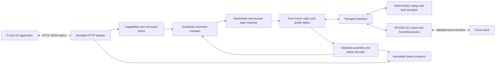

# Pico W Gecko bridge implementation plan

Proposal v0.1, 2026-11-15. **Review before implementation.**

Milestone update: subsequent user instructions authorize the portable host core
through T08 host simulation and T09 simulation firmware implementation,
cross-compilation and offline validation only. Stop before flashing, deployment or T10. See
[ROADMAP.md](ROADMAP.md), [PROTOCOL_EVIDENCE.md](PROTOCOL_EVIDENCE.md),
[LICENSING.md](LICENSING.md) and [VALIDATION.md](VALIDATION.md) for current status.
The original architecture/backlog below is retained as planning history; its
physical bus, deployment and control stages remain unapproved and unimplemented.
T09's native Pico/Wi-Fi simulation code is compiled but not hardware validated.
The isolated-bench follow-up adds a single Windows verification/provisioning/check
runner and redacted reports; see ISOLATED_BENCH.md. It performs no automatic
flashing, and no device access occurs in this workspace. T10 stays out of scope.

Repository: `Bubchez/gecko-rp2040`; branch: `feature/pico-w-bridge`.
Baseline: `3baacda4c0e3ae58e8b014692cf5f146db2b3318`.
Scope: one Pico W replaces Nano I²C proxy and ESP32/ESPHome controller for
Gecko IN.YE-3-H3.0 / YE-3-CE, V2. Pi Zero W software is external and unchanged.
The user confirmed there is no existing bridge HTTP contract; `/api/v1` is proposed
in [HTTP_API_V1.md](HTTP_API_V1.md) for agreement with that application's developer.

## Recommendation and decision gates

Use the Raspberry Pi Pico C/C++ SDK, CMake, a hardware-independent C++17 protocol
library, a deterministic simulator, and an HTTP JSON adapter over CYW43/lwIP.
Keep firmware, tests and documentation in `pico_w/`. Preserve the entire Arduino
and ESPHome implementation as the reference. No merge to master without review.

The first implementation should run the protocol and HTTP contract against replay
on a host, then a Pico W with its Gecko pins inactive. It must label simulated data.
Physical receive and handshake work follows only after interface review. Physical
actuator writes are a later, separately reviewed release; neither HTTP nor a reboot
may enable them. Do not add a generic raw-I²C write endpoint.

The main feasibility uncertainty is reliable half-duplex master/slave switching on
the shared bus under Gecko traffic. A working master-only demo is not proof of this
replacement. No offline test can establish electrical compatibility, actual Gecko
deadlines, or collision behavior. Schedule the hardware validation milestone around
hardware availability rather than promising a calendar completion date.

## Protocol knowledge to retain

The detailed source inventory and defects are in [REPOSITORY_REVIEW.md](REPOSITORY_REVIEW.md).
Reuse the following as candidate protocol specifications with provenance, not as
unconditional guarantees for every YE-3 V2 pack:

- 7-bit address `0x17`, nominal 100 kHz, independent inbound writes and outbound
  write/repeated-start/read-two/STOP; inbound read response currently `00 00`.
- GO and fixed ACK/LO patterns, C/S XML filename version discovery, clock layout.
- XOR command trailers; version bytes; temperature in 1/18 °C, big-endian.
- v50/v51+ status offset tables, flags and pump-demand versus pump-output distinction.
- Program enumeration and reminder record layout, with date validity and provenance.

Extract checksum/byte readers, frame classification, command encoders, offset
profiles, calendar arithmetic and state decoding into pure functions. Repair
validation as part of extraction; preserve golden observations rather than bugs.
Keep ESPHome publishing, entity wrappers, Python codegen, HA time/preferences,
UART hex transport, Nano reset/bootloader recovery, ESP32 configuration and AVR
Wire outside the new core. No production dependency on Arduino or ESPHome.

## RP2040 transport feasibility and timing

The RP2040 has two I²C instances with 16-entry FIFOs. Datasheet §§4.3.3/4.3.10
prohibit one instance operating simultaneously as master and slave. Multi-master
arbitration is supported in master mode (§4.3.8), but software cannot assume that
losing arbitration immediately makes a master become a ready slave at its address.
See the primary-source links and SDK inspection in the review.

### Candidate driver: one peripheral, explicit role state machine

Use one I²C instance; GPIO4/5 on i2c0 are a tentative pin choice, subject to board
and interface review. In simulation builds do not select an I²C pin function at all.
One transport owner controls the peripheral, IRQ mask, FIFOs, transaction state and
recovery. Master functions must never run while the slave handler owns its IRQs.

```text
INACTIVE -> SLAVE_LISTEN -> SLAVE_RX -> SLAVE_READ_REPLY -> SLAVE_LISTEN
                    |
                    +-> WAIT_BUS_IDLE -> MASTER_WRITE
                          ^                 |
                          |          repeated START
                          |                 v
                          +---------- MASTER_READ_2 -> STOP -> RESTORE_SLAVE

Any timeout/abort/loss -> classify outcome -> bounded recovery -> SLAVE_LISTEN
Persistent fault -> FAULT_RELEASED (pins released, writes inhibited)
```

1. In slave mode drain RX FIFO promptly into an owned bounded raw frame. Preserve
   address/direction, STOP/repeated-START boundary and timestamps. On a read request
   supply the two-byte response promptly; this is a bus response, separate from
   the 15-byte application ACK sent later as a master.
2. Complete the slave transaction including any read phase before changing role.
   Wait for observed bus idle for at least the standard-mode tBUF minimum (4.7 µs),
   plus any evidenced pack-specific quiet interval. This reduces collisions but
   cannot prevent another master's simultaneous START; hardware arbitration still matters.
3. Quiesce the slave IRQ path, check residual RX/boundaries, request disable and
   wait for `IC_ENABLE_STATUS` with a bounded deadline per datasheet §4.3.10.3.
   Configure master, target 0x17, then enable. Inspect the selected SDK rather than
   assuming `i2c_set_slave_mode()` alone provides a complete safe switching sequence.
4. Execute bounded write, **no STOP**, repeated START, read exactly two bytes,
   final NACK/STOP. Keep ownership across both phases. Do not reinitialize, change
   role, or lose SDK `restart_on_next` state between them. Check exact transferred
   byte counts and preserve abort cause before clearing it. Use an overall deadline
   spanning both phases; do not reset an unbounded deadline on every byte.
5. After STOP/abort, clear residual flags and FIFO state deliberately, restore
   slave address, IRQ masks and handler, and re-enable listening. Record the
   listener's blind interval and any disable/restore failure.
6. Handle timeout while no-STOP is active explicitly: the datasheet warns that
   disable can leave SCL held low until another command or ABORT. A proven abort
   and release path is required; merely calling deinit is not sufficient evidence.
   Never reset the Gecko pack as a recovery action. No blind nine-clock bus clear
   on an active multi-master bus; only consider it after ownership/electrical review.

SDK master errors can collapse arbitration and other abort causes into generic
errors. A thin audited driver extension may be required to report cause, phase and
bytes completed. Treat a failure after data reached the pack as possibly applied.

### Timing budget and limits

At 100 kHz a byte plus ACK is approximately 90 µs. A 78-byte inbound write takes
about 7.11 ms including address, or 7.38 ms with a repeated-start address and two
read bytes; stretching, START/STOP and switching add time. A 20-byte command plus
two-byte read uses about 2.16 ms; GO/ACK with 15 bytes uses about 1.71 ms. Those are
wire-time estimates, not safe application ACK deadlines.

Sixteen FIFO entries correspond to about 1.44 ms of wire time from empty at this
rate. Once nearly full, slack is far shorter. Target ISR service under 25 µs and
continuous draining; measure maximum IRQ blackout and SCL stretch under Wi-Fi and
USB load. Do not place JSON, logging, allocation, checksums or handshake logic in
an ISR. The initial 25 ms transaction timeout is a simulator/bench starting point
from the AVR design, not a verified Gecko or I²C-standard deadline.

Keep GO cadence, handshake step deadline, assembly expiry and post-LO quiet time
as profile parameters. Start simulation with current code's 23 s GO, 60 s stale
threshold and the documented 10 s clock-write delay, explicitly tagged unverified.
Propose 1 s per handshake step and 250 ms multipart gap for fault tests; tune from
recordings before physical use. A 60 s keepalive statement does not establish an
allowable ACK response latency. Track max/percentile ACK latency on bench and with
the pack and require margin against an observed deadline.

### Alternatives and stop condition

Prototype one-peripheral switching first. If it cannot reliably restore listening
before Gecko responses, stop that approach. Evaluate a PIO-assisted transport with
explicit arbitration, stretching and restart behavior as a separate design review;
PIO is not automatically a correct multi-master stack. Wiring both RP2040 I²C
instances to one bus is also not a ready solution: the local slave can self-ACK
its own master's traffic to the same address, masking peer NACKs and mixing frames.
It needs an independently validated isolation/gating scheme. Do not add it casually.
If no direct implementation meets the measured requirements, report the constraint
instead of quietly retaining a Nano or enabling unreliable commands.

## Proposed firmware architecture



Both simulator and RP2040 adapter implement the same transport contract. Parser
and API never access registers. HTTP requests enqueue intent; they do not call
I²C synchronously. Reading status returns the latest validated snapshot without
initiating physical traffic.

Proposed layout, created only after plan review:

```text
pico_w/
  CMakeLists.txt                # host and Pico targets; no ESPHome import
  cmake/                       # pinned SDK import/toolchain settings
  include/gecko/               # bounded views, types, module interfaces
  src/core/                    # codec, assembly, profiles, status, dates
  src/session/                 # handshake and command manager
  src/transport/               # interface and simulator
  src/platform/rp2040/         # I2C, clock, queues, board config, persistence
  src/net/                     # CYW43/lwIP, HTTP/JSON, authentication
  src/app/                     # composition, modes, boot, diagnostics
  tests/unit/                  # host pure-function tests
  tests/scenarios/              # session/transport fault cases
  tests/api/                   # contract tests against host simulator
  fixtures/                    # complete annotated examples and recordings
  tools/                       # fixture validation and replay utilities
  docs/                        # this plan, review, API, future bring-up records
  review/                      # current baseline characterization only
```

### Module contracts

| Module | Input / output | Invariants |
|---|---|---|
| Transport | `submit(TxRequest)`; `poll(now)`; events `RxFrame`, `TxResult`, `Fault` | Raw frames bounded to initially 128 bytes; immutable owned data; transaction includes write/read/STOP; cause/phase/counts explicit. No silent truncation. |
| Codec | byte view → typed frame/error; typed command + profile → bounded bytes/error | No hardware, allocation, timers or side effects; validate before indexing; reject unknown routing/type/version as appropriate. |
| Assembly | validated fragment + session + time → complete payload/error | Initial 512-byte cap; gap/total deadline, consistency checks, drop whole message on loss/overflow. Do not invent wire sequence numbers if none exist. |
| Profiles | C/S filenames + pack evidence → layout and supported fields/commands | Explicit whitelist with provenance. Unknown pack/version remains diagnostic and cannot enable control. |
| Session | typed frames, timers and TX results → handshake state and planned transactions | Explicit state and deadlines; handle duplicate/out-of-order config, clock and LO. ACK only validated recognized messages in permitted modes. |
| State store | validated decoder result → atomic immutable snapshot | Observed values distinct from desired; per-field validity/age; unknown is not false or 0 °C. Rejected input does not refresh state age. |
| Command manager | typed desired action + preconditions → bounded lifecycle record | Serialized, expiring, correlated, no optimistic status update; bus ACK/read response is not confirmation of applied effect. |
| Policy | mode, hardware approval build, local arm, profile, freshness, fault state | Defaults deny writes. Enforce below HTTP too; simulator and diagnostics cannot bypass physical safety policy. |
| HTTP adapter | bounded HTTP/JSON → validated requests / cached JSON | v1 contract, authentication, sizes/timeouts, fixed concurrency, no register access or raw command endpoint. |
| Persistence | versioned device config and validated reminder cache | CRC/schema; avoid per-frame flash writes; secrets redacted; cached fields explicitly marked cached. Never persist/replay pending actuator requests. |

Use fixed-size arrays/rings and explicit result types in the core. Prefer bounded
byte views (C++17 custom view) and endian helpers over packed struct casts, bitfield
layout assumptions or unaligned loads. Retain raw temperatures alongside converted
values. Use injected monotonic 64-bit microseconds; separate wall time from expiry.

### Scheduling, memory, and Wi-Fi

Start without an RTOS. On Pico, dedicate core 1 to I²C ownership and fast transport
service; core 0 owns CYW43/lwIP polling, protocol/session, HTTP and snapshots. This
keeps networking away from peripheral IRQ work. First validate single-core HAL in
a no-network bench target, then introduce the queues and Wi-Fi load. Initialize
the peripheral/IRQ on its owner core; use bounded SPSC queues with proper acquire/
release semantics or SDK primitives, not volatile-only shared structs. Publish
snapshots by copy or short protected swap. No blocking cross-core calls in an ISR.

Use `pico_cyw43_arch_lwip_poll` as the first networking candidate so callbacks have
explicit owner context. Cap work per loop; process protocol events before HTTP
serialization. Measure whether bounded master calls on core 1 preserve network
responsiveness. ISR-critical code/data should reside in SRAM where needed. Flash
erase/program can stall both cores/XIP: provision and update only with the bus
inactive until a separately validated flash-safe design exists. USB flashing first;
OTA is deferred, not assumed available from ESPHome.

RP2040 has 264 KiB SRAM, but Wi-Fi/lwIP, stacks and TLS can dominate it. Initial
application budget (targets to measure, not observed consumption):

| Allocation | Initial bound |
|---|---:|
| RX frame queue | 16 × (128-byte payload + metadata), under 3 KiB |
| Outgoing transactions | 8 × bounded 32-byte command + metadata, under 1 KiB |
| Assembly | 512 bytes plus metadata |
| State snapshots and bounded diagnostic ring | 8 KiB target |
| HTTP connections | 2; 2 KiB header + 512-byte body and up to 8 KiB response each |
| Command history | 32 records; idempotency retention 15 min; reject new work if unexpired records fill it |
| Stacks, networking, runtime | Measure independently using link map, stack watermarks and sustained load |

A full RX ring drops complete new frames and raises a loss generation counter;
invalidate any affected assembly/session. Don't block an ISR waiting for the main
loop. Track queue high-water marks, overruns and heap minima. Set a release target
of at least 25% SRAM headroom after measured worst-case operation; adjust the above
bounds from real measurements. Start with no production TLS promise; see the API's
network security decision. Enable a watchdog only after fail-safe pin release and
timeout paths are demonstrated; do not copy the legacy README's watchdog advice
as an RP2040 design rule or ignore it without testing reset behavior.

## Session and command behavior

Session states: `disabled`, `disconnected`, `go_pending`, `awaiting_files`,
`awaiting_clock`, `awaiting_lo`, `ready`, `backoff`, `fault`.
Permit either C/S filename order only if fixtures justify it. Duplicate valid
messages may require idempotent ACKs; unsolicited LO does not create a ready session.
Reconnect invalidates profile evidence, partial assembly and command preconditions.
Keepalive must not start an overlapping handshake. Use bounded backoff with an
injected random source; prioritize handshake responses over new commands.

Future commands require authenticated API intent, a known enabled capability,
fresh validated state, a complete session, no active transport fault, and both
physical build authorization and local nonpersistent arming. Proposed lifecycle:
`queued -> transmitting -> awaiting_observation -> confirmed | failed | expired |
indeterminate`. A validation rejection never creates a bus transaction.

Transmit only one actuator change at a time. Preserve other pumps' *fresh user
demand* bits, not output flags, in shared-demand writes. Require an updated demand
observation before the next shared-byte write. If the wire protocol has no command
correlation ID, allow one in flight and match subsequent status conservatively;
matching values are observed convergence, not proof this request caused them.

Retry only a demonstrated definitely-not-sent phase, with bounded attempts and
backoff. Partial writes/read-phase failure and timeout after possible application
become `indeterminate`; no automatic resend. Expire queued commands on disconnect,
profile change, disarm, loss of fresh state or client deadline. Never replay at
boot or after a Wi-Fi outage. Heater is status-only; no direct heater override,
filter schedule, standby, experimental pumps, reminder resets or automatic clock
sync in the initial control milestone. Light is only a candidate first control
and still needs observed validation on this pack.

## Offline test and simulation strategy

Use a host CMake target independent of the SDK. Prefer a lightweight reviewed test
runner (or existing standard assertions initially), with ASan/UBSan and strict
warnings. Keep baseline characterization separate from future correctness tests.

The simulated transport accepts a scenario, an injected clock and seed, and emits
the same RX/TX result events as the HAL. It must test both directions, role states,
write/read phases and restoration, not simply hand the parser a status struct.
Provide deterministic expected-TX matching with masks only for declared dynamic
fields; unexpected writes fail a scenario. Run the identical core on the host and
on Pico simulation firmware with GPIO inactive. Host HTTP simulator serves the
same contract for the external Pi app developer without modifying that app.

Each fixture records: schema version, source commit/file/line or capture ID,
`origin = documentation | synthetic | hardware_capture`, pack and C/S versions if
known, monotonic relative timestamps, direction/address, complete hex bytes,
STOP/restart/read boundaries, expected validity/checksum policy, decoded fields,
unknown fields and confidence. Keep raw captures immutable; normalized fixtures
are derived with a tool/version. No ellipses in accepted frame fixtures. The
README's incomplete `RX:78:...` cannot be used as a golden complete status.

Example fixture event shape (synthetic transaction failure, not a recording):

```json
{"schema_version":1,"origin":"synthetic","events":[
  {"at_us":1000,"event":"expect_tx","address":23,
   "write_hex":"17000000001709000000000001474F","read_length":2,"repeated_start":true},
  {"at_us":2000,"event":"tx_result","phase":"address_write",
   "result":"address_nack","write_count":0,"read_count":0}
]}
```

| Test group | Minimum acceptance cases |
|---|---|
| Byte/command codec | Temperature golden values 26, 36.5, 37, 40 °C; reject NaN/Inf/out of range/nonquantized requests; checksums and output capacity boundaries; version bytes; pump masks for all bit combinations. |
| Raw frame validation | Length 0..maximum+1, truncated headers, invalid family/direction/address, malformed hex import, negative/overflow length, unknown type and checksum mutation; recognized exceptions handled explicitly. |
| Reassembly | Exact 78/78/54 synthetic sequence; captured sequences when available; 120/162/170/390/405/512 boundaries; missing/duplicate/reordered/mixed-session fragments, stale tail, overflow and reset. Never publish mixed/truncated status. |
| Status profiles | v50 and v51 candidate tables, bitfields, unknown enum 3, zeros/sentinel/absurd temps, endian differences, combined tail bounds, unknown version/pack, no false fresh/connected state. |
| Clock/reminders | Leap days, month/day/time bounds, time-only dates, DST-independent day addition, uint16 interval extremes, malformed ID/order, cached vs fresh and invalidation. |
| Session | Both evidenced filename orders, missing clock/LO/ACK, duplicate config, unsolicited LO, GO overlap, retries exhausted, monotonic wrap conversion and long idle; no busy retry loops. |
| Transport model | Arbitration loss in each phase, address/data NACK, short read, clock stretch, stuck SDA/SCL, delayed STOP, incoming frame during TX, role restore failure and queue saturation. No actuator retry when possibly applied. |
| Command policy | Every mode/capability/freshness combination, duplicate request IDs, conflict vs retry, shared-pump stale RMW, expiry/disconnect/reboot, late readback and no optimistic state. |
| HTTP contract | Status and capabilities with nulls/stale/cache/sim labels; authentication, size/time limits, malformed/duplicate JSON keys, unknown fields/types, conflicting IDs, busy queue, all error/status codes. GET produces no bus activity. |
| Fuzz/soak | Seed corpus from complete examples; randomized lengths and byte mutations under sanitizers; bounded runtime/memory; deterministic scenario replay and sustained HTTP polling/Wi-Fi reconnect tests. |

QEMU-style CPU emulation is not an I²C multi-master validation. Simulator success
is a gate to bench testing, not permission to connect a spa.

## Safe development and acceptance gates

| Gate | Allowed behavior | Evidence required to exit |
|---|---|---|
| G0: plan/provenance | Documents and host review only | Review architecture, API, backlog and upstream license gaps; agree scope. Current deliverable stops here. |
| G1: offline core | Host simulation only | Bounds-checked core, fixture provenance, sanitizers and deterministic fault tests pass; no physical HAL linked into host simulator. |
| G2: Pico simulation | Pico Wi-Fi + replay; Gecko GPIO remain inputs/inactive | Reproducible UF2, network/API contract, stale state, queues/memory/soak evidence; physical TX code excluded by build. |
| G3: electrical/bench | Electrically reviewed non-spa test rig | Measure bus voltage/pullups/rise time, open-drain level shifter, ground/isolation and power/backfeed; two-master emulator + logic analyzer validates bursts, restart, stretch, collision, timeouts and released pins on reset. |
| G4: passive pack observation | Capture-only, no START/ACK/read response driven | Hardware available, qualified interface sign-off; compare actual YE-3 V2 traffic to fixtures. Passive may show little traffic without a registered participant; do not infer failure from silence. |
| G5: active read-only pack | Explicitly approved GO/handshake ACK/two-byte bus responses only | Known profile validated; measured reply deadlines, no spontaneous actuator commands, 24 h read-only run and comparison with keypad/known observer, Wi-Fi outages and Pico resets safe. This is electrically active participation, not passive observation. |
| G6: limited write validation | One enabled feature at a time under local supervised arming | Separate code review, electrical/protocol sign-off recorded with capture IDs, readback and failure paths proven; no commands on boot/reconnect, loss of readiness inhibits commands. |
| G7: release review | Only validated pack/features | License notices resolved, reproducible build/artifacts, API agreement, memory/timing evidence, rollback/runbook and reviewed PR. Master merge requires review. |

Electrical gate specifics: RP2040 GPIO are **3.3 V and not 5 V tolerant**. The Nano
being a 5 V device is not a measurement of this bus. Verify real high/low levels,
pullups and cable capacitance; select a bidirectional open-drain interface that
preserves arbitration and stretching and releases both lines when unpowered.
Do not reuse the UART resistor divider on I²C. Review grounding/isolation relative
to the mains-powered pack and supply design; no direct Pico-to-spa connection
based solely on the existing pinout image. Keep ordinary Gecko safety controls
and keypad authoritative; loss of bridge must leave native control working.

## Prioritized implementation backlog

Effort is focused engineer-days including local tests/review fixes, not elapsed
delivery dates. Dependencies and gates are more reliable than estimates while
hardware is unavailable. Tasks requiring upstream answers or pack access remain
explicitly blocked rather than simulated away.

| Task | Priority | Depends on | Estimate | Concrete completion criterion |
|---|---|---|---:|---|
| T00 Review this proposal | P0 | Current deliverable | 0.5–1 | Architecture/API/gates accepted; any scope changes recorded; no firmware rewrite before this. |
| T01 Provenance/license inventory | P0 | T00 | 1–2 + external wait | Missing MIT grant clarified, Wire and borrowed offsets/assets traced, notices plan reviewed; redistribution gate closed until resolved. |
| T02 Reproducible build and CI design | P0 | T00 | 1–2 | Pin SDK/toolchain/test dependencies; separate host and pico_w targets, sim default, no physical writes; CI checks restricted to new paths initially. |
| T03 Fixture schema and corpus | P0 | T00 | 1–2 | Complete documented commands tagged documentation; synthetic status/handshake tagged synthetic; fixture validator rejects truncated examples; source attribution retained. |
| T04 Pure safe frame codec | P0 | T01 copying decision, T02/T03 | 2–4 | Explicit bounds/endian/checksum policy; characterization faults become rejection tests; golden encoders and malformed inputs pass sanitizers. |
| T05 Reassembly/profile/status core | P1 | T04 | 3–5 | Full assembly invalidates on loss/expiry; profile/field confidence and length validation; unknown values cannot silently become valid state. |
| T06 Deterministic transport simulator | P0 | T02/T03, interface agreed with T04 | 2–4 | Clock/seed controlled scripts, expected TX, phase faults and restore/loss events; no hardware access. |
| T07 Session and read-only policy | P0 | T04–T06 | 2–4 | Explicit handshake/deadline/backoff tests, no overlapping GO, modes enforced below API, actuator writes structurally inhibited. |
| T08 Host HTTP contract/mock | P1 | T05–T07, API agreement | 2–4 | Pi app developer can poll `/api/v1` and test read-only rejections; contract fixtures and bounds/auth errors pass. Pi app untouched. |
| T09 Pico simulation + Wi-Fi | P1 | T02/T06–T08 | 2–4 | Identical core runs on Pico with pins inactive; two-client HTTP load, reconnect, memory/stack/queue measurements and simulator labeling. |
| T10 Electrical interface design | P0 physical blocker | T00; actual measurements needed | 1–3 + access wait | Reviewed schematic, levels, pullups, isolation/power/reset plan and test points; no assumption that 5 V is safe. |
| T11 RP2040 I²C role-switch spike | P0 feasibility blocker | T07/T10, bench equipment | 3–6 | Write/restart/read/STOP and listening restored; RX/burst/stretch/arbitration tests with logic captures, classified failures and measured blackout. Stop/review alternative if it fails. |
| T12 Network/transport stress integration | P1 | T09/T11 | 2–4 | Cross-core queues, ISR latency, no frame mix/loss without counters, no unsafe flash write/reset path, worst-case headroom established. |
| T13 Passive Gecko capture/profile confirmation | P0 hardware blocker | T10/T11, pack access | 1–3 + access wait | Capture actual YE-3 V2 versions/transactions and reconcile docs; no bus drive; fixtures include actual provenance. |
| T14 Active read-only validation | P0 before control | T12/T13 + G5 approval | 2–4 + 24 h soak | GO/ACK-only participant, timings/profile/status match pack/keypad, recovery safe; no actuator writes. |
| T15 Command manager + simulated write API | P1 deferred | T07/T08; separate review | 3–5 | Auth/preconditions/idempotency/expiry/indeterminate outcomes and stale pump RMW tested entirely offline; production physical writes still disabled. |
| T16 Supervised limited control | P0 control gate | T14/T15 + separate G6 sign-off | 2–4 per feature | First feature confirmed by status and physical observation, each new capability separately verified; no experimental pumps/clock automation by default. |
| T17 Release/runbook | P1 | T01, applicable validated features | 1–2 | Dependency notices, archived captures, build hashes, flashing/rollback, API version compatibility and reviewed PR; no automatic merge. |

Parallel development, if scheduled by the project team: fixture/core/simulator work
can progress alongside electrical design; host API can follow validated state types.
No parallel agents or external work have been commissioned by this review.
The immediate post-review milestone is **T02–T08, offline read-only bridge**, with
T01 controlling copying/redistribution and T10/T11 controlling physical feasibility.
No firm estimate for usable spa control is justified before T11/T13 results.

## Review decisions to record

1. Accept SDK/C++17, module boundaries, simulator-first approach and mode gates.
2. Accept `/api/v1` pull-based HTTP proposal and coordinate with the separate app
   developer without changing that app. Decide isolated-LAN bearer HTTP versus
   a measured TLS build before credentials cross an untrusted network.
3. Agree who supplies pack access, logic-analyzer recordings and electrical review.
4. Resolve exact upstream licensing and Geckolib provenance before distribution.
5. Decide initial feature scope: read-only status first; future light/setpoint/program
   or pump control only according to independently verified capabilities.

This deliverable is the review point. It adds no Pico firmware, does not connect
physical hardware, and does not approve any actuator control.
